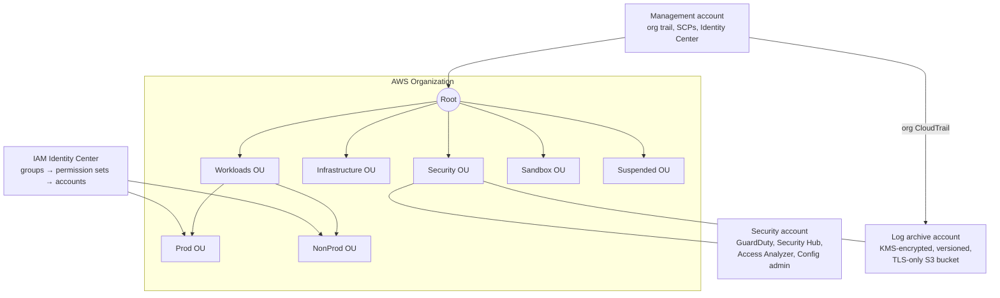

# AWS Landing Zone (Terraform)

[](https://github.com/Ahmadshen/aws-landing-zone-terraform/actions/workflows/ci.yml)

A multi-account AWS foundation built as small, tested Terraform modules: **AWS Organizations**, **service control policy (SCP) guardrails**, **IAM Identity Center** access, **account vending**, an **organization CloudTrail** into a locked-down log archive, and delegated security tooling.

It's the setup I build for companies moving from "one AWS account with IAM users" to a governed organization: least-privilege access through SSO, guardrails nobody can switch off, and an audit trail nobody can delete.

## What you get



| Module | What it does |
|---|---|
| [`organization`](modules/organization) | Organization with all features, trusted service access, a two-level OU hierarchy (validated) |
| [`scp`](modules/scp) | Five opt-in guardrails: **deny leaving the org**, **deny root user**, **region allowlist** (global services exempt), **protect CloudTrail/Config/GuardDuty/Security Hub/Access Analyzer**, **require IMDSv2**. Break-glass roles can be exempted. |
| [`identity-center`](modules/identity-center) | Permission sets (managed + inline policies, session length validated to ≤ 12h), groups, and group-only account assignments. No IAM users. |
| [`account-vending`](modules/account-vending) | Creates member accounts into OUs with tags. `close_on_deletion = false`, so deleting code never closes a real account. |
| [`log-archive`](modules/log-archive) | KMS key with rotation, S3 bucket with versioning, bucket-owner-enforced ownership, all public access blocked, TLS-only policy, Glacier tiering and ~7-year retention. CloudTrail writes are scoped to the exact trail ARN (confused-deputy protection). |
| [`security-baseline`](modules/security-baseline) | Organization-wide, multi-region CloudTrail with log file validation; delegates GuardDuty, Security Hub, Access Analyzer and Config to the security account. |

[`examples/complete`](examples/complete) wires all six together the way a real organization would.

## Tested without an AWS account

Every module ships `terraform test` suites that run against **mocked AWS providers**, so CI needs no credentials:

- the hierarchy rejects 3-level OU trees
- every rendered SCP is valid JSON, under AWS's 5,120-character limit, and never contains `"Condition": null` (which AWS rejects)
- the region allowlist exempts break-glass roles
- the log bucket blocks all public access, denies non-TLS requests and scopes CloudTrail writes to the org trail
- removing an account from code never closes it
- duplicate account emails and >12h SSO sessions are rejected at plan time
- **the full stack plans before any account or OU exists**. This test caught a real bug: resource keys derived from IDs that are unknown until apply, which breaks the first `terraform apply` on a fresh organization. Keys now use stable names.

```bash
make test      # 17 tests across 7 suites, about 20 seconds
make lint      # tflint + AWS ruleset
make scan      # Trivy: fails on HIGH/CRITICAL misconfigurations
make ci        # everything above + fmt + validate
```

## Using it

> ⚠️ This changes your AWS Organization. Run it from the **management account**, review every plan, and start with a test organization.

1. **Bootstrap** the security and log-archive accounts (`modules/account-vending` or the console). Their IDs are inputs, because the log-archive provider needs one to assume a role.
2. Copy and edit the example:
   ```bash
   cd examples/complete
   cp terraform.tfvars.example terraform.tfvars
   terraform init && terraform plan
   ```
3. Enable IAM Identity Center in the management account once (console). The `identity-center` module discovers the instance automatically.

### Plan in CI with OIDC (optional)
[`.github/workflows/plan.yml`](.github/workflows/plan.yml) runs a real `terraform plan` on pull requests using **GitHub OIDC**, with no stored AWS keys. Create an IAM role trusting `token.actions.githubusercontent.com`, restricted to this repository, with read-only permissions. Set the repo variable `AWS_PLAN_ROLE_ARN`. Until then, the job is skipped.

## Design decisions

- **Guardrails are opt-in per target.** `attachments = { guardrail = { label = target_id } }`. Static labels keep plans working before OUs exist; nothing is attached unless you say where.
- **Policies are built with `jsonencode`, not `aws_iam_policy_document`.** That keeps the rendered JSON assertable in tests, including under mocked providers.
- **Groups, never users.** Assignments only target Identity Center groups, so access reviews mean reviewing group membership.
- **The management account stays empty.** Security services are delegated to a dedicated security account; logs live in a separate account that the people being audited can't touch.
- **Deletion is never destructive.** Accounts don't close when removed from code; the log bucket can't be force-destroyed.

## Roadmap
- [ ] Security account side: GuardDuty / Security Hub auto-enable for new accounts
- [ ] AWS Config conformance packs and an aggregator
- [ ] Tag policies and backup policies
- [ ] Budgets per OU with alerts

## License
MIT
